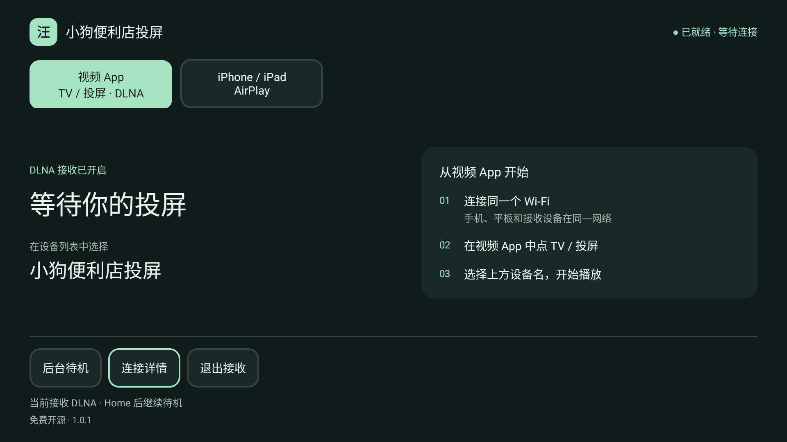

# 小狗便利店投屏 · 1.0.1

安卓电视／平板上的 DLNA 与 AirPlay 接收端。一个安装包、一个图标，原包名 `cn.local.livingroomcast` 和签名不变，可以覆盖1.0.0或旧主版。无账号、广告、订阅或人为播放时长限制，GPL-3.0开源。

1.0.1 的两项更新是“夜色客厅”界面与 AirPlay 后台待机。两个模式共用等待页，地址与诊断收进连接详情；进入 AirPlay 后按 Home 继续待机，再开图标回到当前模式。左上方“视频 App”切回 DLNA；模式仍互斥。完整使用方式见 [1.0.1 说明](docs/1.0.1.md)。

下载 [1.0.1 APK](https://github.com/leiz56638111-create/puppy-store-cast/releases/download/v1.0.1/PuppyStoreCast-1.0.1.apk)，或查看 [发布说明、对应源码与校验文件](https://github.com/leiz56638111-create/puppy-store-cast/releases/tag/v1.0.1)。[1.0.0](https://github.com/leiz56638111-create/puppy-store-cast/releases/tag/v1.0.0) 和旧独立实验包保持不变。自行构建方式见下方。



## 功能

- DLNA：局域网发现，接收HTTP(S)、HLS、DASH视频地址，播放／暂停／停止和音量控制。
- 保留真实解码尺寸显示、片源提供且设备支持的画质选择；不会给单档视频凭空增加清晰度。
- 保留触摸与遥控器、进度条、0.5–2倍速；直播仅按片源实际回看能力开放跳转/倍速，提供回到直播。
- DLNA播放成功后信息层立即隐藏；触摸画面或方向键唤出控制，闲置约2秒收起。
- DLNA可后台待机，收到新投屏后尝试自动打开；系统限制下可能需要手动打开。自动弹出授权沿用原逻辑。
- AirPlay：App内视频隔空播放、视频流／控制中心屏幕镜像、音频接收；支持中文连接详情、暂停／继续（地址视频）、重新连接、遥控器和触摸。
- AirPlay可后台待机；有授权且系统允许时，有效投送会尝试打开画面。无授权时需手动打开，超时后需重新投送；播放中按Home结束本次会话、继续等待。
- AirPlay沿用对照版的原生音频缓冲／时间线、FFmpeg后备、Oboe、解码器选择和持久Surface渲染；保留默认设置。
- 连接详情在本次运行内存保存，隐藏视频地址和授权内容。

应用不提供节目、直播源或账号授权服务。DLNA清晰度/进度/倍速功能不直接套用到实时AirPlay镜像。

## 安装与使用

1. 将PuppyStoreCast-1.0.1.apk拷到U盘，通过电视文件管理器安装，可直接覆盖旧主版。
2. 打开“小狗便利店投屏”，发送端与电视连接同一家庭局域网。
3. 安卓视频App：点TV／投屏，选择“小狗便利店投屏”。
4. iPhone／iPad：先点电视首页的“AirPlay”，再从相册视频或视频App内选择隔空播放，或从控制中心选择屏幕镜像；设备名均为“小狗便利店投屏”。
5. AirPlay页面左上方“视频 App”切回DLNA；等待页按返回键打开后台待机提示，播放中返回结束本次投送。两种模式按Home均可待机；重新打开图标恢复原模式。“退出接收”停止服务。

测试新版时先退出其他接收软件，包括独立上游对照版，避免手机选错或端口冲突。不需要卸载旧的独立实验包。

## 兼容与边界

- DLNA最低Android6.0/API23；AirPlay需要Android7.0/API24以上的ARM设备。APK含arm64-v8a与armeabi-v7a，32位运行及API23实机仍未在本轮验收。
- 用户先前反馈Sony XR-85X95EK与安卓平板的Z视介、小红书、抖音可投；本次又确认独立AirPlay对照版整体可用，但未提供逐App、时长、机型与同步明细。合并包需要分别复测，不能据此宣称所有App兼容。
- AirPlay默认自动分辨率、申请最高60fps、AAC开启、ALAC广播关闭、自适应音频缓冲、预约呈现关闭。申请值、输入帧计数不等于电视实际显示FPS；广播尺寸不等于当前视频画质。
- 当前模式可后台待机；后台打开画面受系统版本和授权限制。不开机自启，电视深度待机、强制停止或厂商清理可能结束服务；不承诺一直在线。
- 不支持Miracast、Chromecast或跨网投屏。不绕过DRM/版权授权；App是否支持外播取决于其投送方式与限制。
- 4K60/HDR、游戏延迟、长期声画同步、历史无声与横向花屏问题仍需真机验收，不因版本号更新而视为全部解决。
- 同网发现可能受访客网络、AP隔离和Mesh组播策略影响；局域网DLNA控制没有配对认证，不应映射到公网。

1.0.1 [社媒海报](docs/images/poster-1.0.1.png)与[功能介绍](docs/release-1.0.1-intro.md)；1.0.0历史海报和介绍保留。

## 构建

配置JDK17/21的JAVA_HOME和Android SDK的ANDROID_HOME，需要SDK36、build-tools35.0.0、NDK28.2.13676358、CMake3.22.1、Python3.12+、Git、Make、Perl。

```sh
bash build-local.sh
```

输出`app/build/outputs/apk/debug/app-debug.apk`。原生依赖均来自随源码提供的固定源档；首次构建Java/Gradle依赖仍需网络。自行构建会生成自己的本地测试签名，不能覆盖作者签名的同包名安装包；源码包不含作者签名或配对私钥。

## 验证与来源

1.0.1的使用与边界见[更新说明](docs/1.0.1.md)；合并历史见[1.0.0合并说明](docs/combined-1.0.0.md)、[测试入口](TESTING.md)和[AirPlay模块](airplay/README.md)。模拟器/合成媒体/回调注入不替代真实Apple握手及长期电视播放验收。

AirPlay基于[jqssun/android-airplay-server v0.0.36](https://github.com/jqssun/android-airplay-server/tree/v0.0.36)，固定上游与修改在[AirPlay许可说明](airplay/NOTICES.md)和`airplay/vendor/sources.json`。1.0.0的主包不再包含旧`:mirror`引擎；其源代码和历史记录仍保留。完整许可见[LICENSE](LICENSE)与[THIRD_PARTY_NOTICES.md](THIRD_PARTY_NOTICES.md)。
