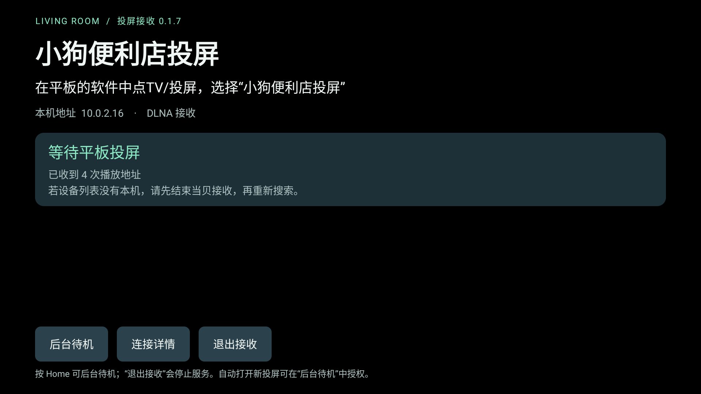
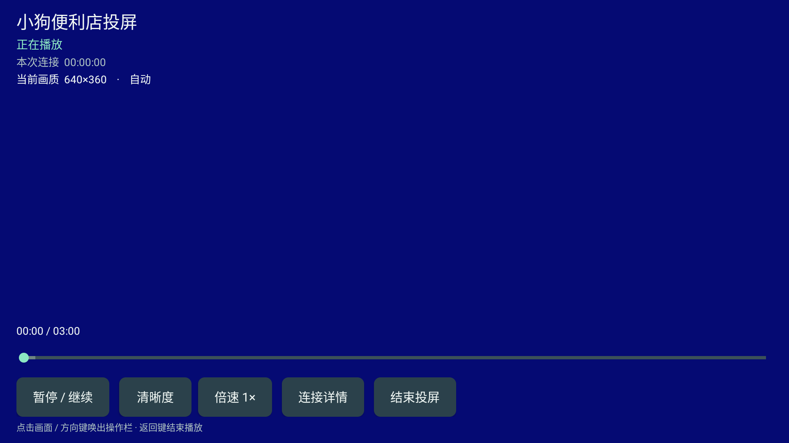
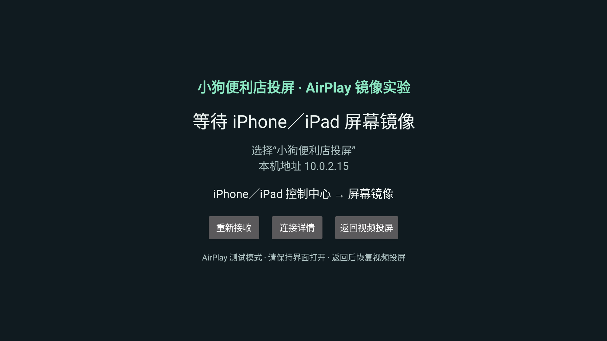

# 小狗便利店投屏

> 当前实验分支新增独立 AirPlay 视频直投包，见 [测试说明](docs/airplay-video-alpha4.md) 和 [模块说明](direct/README.md)。下文描述公开主版 0.1.8，不将实验能力计入主版。

一个用于安卓电视和安卓平板的轻量 DLNA 视频接收端。打开电视上的应用，在平板视频软件中点 TV / 投屏，选择“小狗便利店投屏”。iPhone／iPad 屏幕镜像可从主界面进入 AirPlay 镜像（测试）。

最初用于家里的安卓平板向索尼电视投送直播。没有账号、广告、订阅收费或人为播放时长限制。当前公开测试版为 **0.1.8-test 合并版**：保留 DLNA、触摸、进度条和倍速，增加 AirPlay 屏幕镜像测试入口；一个安装包、一个启动图标，两种模式按需切换。



## 能做什么

- 通过标准 DLNA / UPnP 发现电视并接收视频地址。
- 用 AndroidX Media3 播放 HTTP(S)、HLS 和 DASH 视频，支持基本播放、暂停、停止和音量控制。
- 识别部分把 HLS 错标成 MP4 的视频地址；解析失败时做一次有限内容检查。
- 显示正在解码的视频分辨率；通过“清晰度”选择片源真实提供、电视支持的画质，包含符合条件的 4K。
- 支持返回桌面后后台待机；可选授权后，收到新投屏时尝试自动打开播放界面。
- 支持点击画面唤出控制、触摸暂停／继续、点击或拖动进度条；遥控器聚焦进度条后左右跳转约 10 秒。
- 提供 0.5×、0.75×、1×、1.25×、1.5×、2× 播放；直播按片源回看能力开放跳转与倍速，并提供回到直播。
- 显示连接状态与错误代码；连接记录只保存在内存中，不记录完整视频地址或令牌。

应用只接收发送端提供的视频地址，不提供节目、直播源或账号授权服务。

## 兼容情况与限制

| 项目 | 当前情况 |
|---|---|
| 索尼 XR-85X95EK + 安卓平板 | 用户已反馈 Z视介、小红书、抖音可以投屏；具体 App 版本未记录 |
| Android 11 / API 30 模拟器 | 合成 HLS 播放、基本控制及部分错误恢复曾通过测试 |
| 普通安卓平板触摸接收 | 0.1.7 已去除必须为电视系统的安装要求；触摸交互已做模拟器检查，真机待测 |
| 其他电视、手机和视频 App | 待测试，不保证兼容 |
| 两小时连续播放、声画同步、4K / HDR | 尚未完成验收 |

- 最低 Android 6.0 / API 23，需要允许安装 APK。
- 电视和平板应在同一 IPv4 局域网；访客网络、AP 隔离和部分 Mesh 设置会阻止设备发现。
- 打开一次后，按 Home / 进入后台仍可等待投屏；选择“退出接收”才停止服务。没有开机启动，关机、重启、强行停止后需重新打开。
- 自动打开播放界面需要在“后台待机”中允许“显示在其他应用上层”；未授权或系统阻止时需手动打开本应用。离开正在播放的界面会结束当前播放，避免后台只有声音。
- 系统或电视厂商仍可能回收后台服务；不保证关屏、深度休眠或清理任务后始终在线。
- 新增可选 AirPlay 屏幕镜像测试模式；仍不支持 Miracast、Chromecast、乐联私有协议或跨网投屏。
- 不支持 DRM、需要接收端登录或额外私有请求头的播放链路。地址过期通常需要重新投屏。
- 局域网控制没有配对认证，请在可信的家庭网络中使用，不要将接收端口映射到公网。

## 安装与使用

下载 [0.1.8-test 测试安装包](https://github.com/leiz56638111-create/puppy-store-cast/releases/download/v0.1.8-test/PuppyStoreCast-0.1.8-test.apk)，或查看 [发布说明、源码和校验值](https://github.com/leiz56638111-create/puppy-store-cast/releases/tag/v0.1.8-test)。也可按下节自行编译。

1. 把 APK 拷到 U 盘，通过电视文件管理器打开；按电视提示允许对应应用安装未知来源的软件。
2. 安装并打开“小狗便利店投屏”，确认电视已联网。
3. 平板连接同一家庭网络，在支持投屏的视频软件中点 TV / 投屏，选择“小狗便利店投屏”。
4. 播放成功后信息层立即收起。点击画面或按遥控器方向键可唤出操作栏，约 2 秒无操作后自动收起；暂停、报错及已打开的菜单保持可见。返回键结束本次播放。

按“后台待机”可查看自动打开播放界面的授权说明；按 Home 可直接回桌面待机。常驻通知也提供“退出接收”。

搜不到设备时，先打开一次本应用确认服务已启动，再检查是否处于访客网络或启用了设备隔离。收到地址但无法播放时，查看“连接详情”中的错误代码。

## 触摸、进度与倍速（0.1.7-test）

- 点画面打开控制栏；可触摸暂停／继续、清晰度、倍速、详情和结束投屏。控制按钮至少 48dp，进度条使用 48dp 触摸热区；小屏幕下按钮横向滚动，等待页纵向滚动，弹窗按屏幕大小收敛。当前默认横屏接收。
- 进度与总时长来自当前视频，和“本次连接”计时分开。点播可点击／拖动进度条；拖动时显示预览时间，松手后跳转，保留原来的暂停／播放状态。遥控器聚焦进度条后，左右各跳转约 10 秒。
- 直播只开放片源真实提供的可回看窗口，不会增加服务端没有的回看内容；滑动窗口变化时调整拖动目标。“回到直播”跳到片源默认直播位置并恢复 1×，保留暂停状态。无可回看范围或不支持跳转的片源禁用进度拖动；无法确定播放范围时不开放倍速，并给出说明。
- 播放速度提供 0.5×、0.75×、1×、1.25×、1.5×、2×。本机暂停／继续保留所选速度；新投屏、结束投屏恢复 1×。直播回看使用快倍速追上当前直播位置时恢复 1×；倍速不能提前播放尚未播出的内容。
- 新投屏使旧进度拖动和倍速菜单失效，避免误操作新视频。后台待机和原画质逻辑保留；真实 App 单档清晰度问题仍暂缓。

0.1.7 触摸／进度／倍速仅作用于 DLNA 视频；0.1.8 增加独立的 AirPlay 镜像模式，不把 DLNA 播放控制套用到实时镜像。尚不支持 IJK 或 Chromecast。索尼电视及安卓平板的实际触摸、声画同步和长时间使用仍需分别验收。



## AirPlay 镜像（0.1.8-test）

- 同一个安装包、同一个图标。从等待页点“AirPlay 镜像（测试）”，再在 iPhone／iPad 控制中心选择“屏幕镜像 → 小狗便利店投屏”。
- 镜像模式暂停 DLNA；“返回视频投屏”断开镜像并恢复 DLNA。两种模式按需切换，不同时接收。Home／离开镜像界面停止 AirPlay；重新打开应用默认进入 DLNA。
- AirPlay 请求最高 1080p／30fps，保持来源比例；保留 alpha2 的音频重建、呈现节奏修正、连接详情及“恢复声音”。这些修复是否解决用户真机无声／加速反馈仍需复测。
- DLNA 继续最低 Android 6.0；AirPlay 需要 Android 7.0 及以上 ARM 设备。本合并 APK 提供 arm64-v8a、armeabi-v7a；Android 6.0 入口仅显示说明，不加载镜像原生引擎。
- AirPlay 请保持界面打开；原后台待机仅适用于 DLNA。不承诺视频 App 内 AirPlay 按钮、DRM、ALAC 音频、4K、低延迟游戏或完整苹果设备兼容。
- 覆盖安装原主应用，不会自动合并或卸载历史独立镜像实验包；两者配对记录不同。测试合并版时请先退出独立镜像实验包。

原生组件来源与 GPL／LGPL／Apache 等许可证见 [镜像模块来源](mirror/AIRPLAY-NOTICES.md)。详见 [0.1.8 发布说明](docs/0.1.8-test.md)。



## 画质选择（0.1.4-test）

播放操作栏显示当前解码器输入的实际视频尺寸，例如 1920×1080；这不是电视面板或应用界面的分辨率。

- 默认“自动”，按播放器的网络与设备选择规则播放。
- “清晰度”只列出当前片源确实包含、电视报告为支持的分辨率；同分辨率的多码率 / 编码变体合并显示。
- 若提供 3840×2160 等可播放档位，菜单可选择 4K。画质切换期间实际尺寸可能稍后更新，以解码器报告为准。
- 固定单档片源会提示无法在电视端切换，可尝试在发送端调整后重新投屏。
- 每次新投屏恢复“自动”；旧视频的菜单不能改变新视频。

4K 功能做过 Android 11 模拟器下的合成 H.264 4K / 2fps 测试。真实电视上的 4K / 60fps、HEVC、HDR 及具体视频 App 是否投来多档片源仍需实测。

已有真机反馈：抖音、小红书、B站投屏后，清晰度菜单提示只识别到一个电视可播放的画质档位，无法在电视端切换。原因尚待确认；本版不保证这些 App 的电视端画质切换。


## 从源码构建

需要 JDK 17 或 21、Python 3.12+、Android SDK Platform 36、Build Tools 35.0.0、NDK 28.2.13676358、CMake 3.22.1、make、Perl，以及首次下载依赖所需的网络。工程带 Gradle 8.13 Wrapper，不需要全局安装 Gradle。

macOS / Linux：设置 `JAVA_HOME` 和 `ANDROID_HOME` 后执行：

```sh
bash build-local.sh
```

合并版目前仅验证 macOS 构建，原生依赖脚本支持 macOS／Linux 的 NDK 工具链布局；Windows 构建仍待适配。历史纯 DLNA 的 Windows 说明见 v0.1.7-test 标签。

输出为 `app/build/outputs/apk/debug/app-debug.apk`。

### 签名与升级

构建脚本会为缺少密钥的源码副本生成本地调试密钥。示例密码 `android` 是调试配置，不是生产环境凭据。

公开的 0.1.8-test 安装包沿用此前版本的测试签名，与本地交付的 0.1.8-test 是同一文件；可以覆盖同包名、同签名的已有安装。仓库不包含该签名私钥。不同人自行编译的 APK 签名不同，不能直接覆盖彼此的安装；后续签名安排以各版本发布说明为准。0.1.8-test 合并包的 versionCode 为 9，可覆盖旧主版 0.1.7；历史独立镜像实验包不会被覆盖。

## 测试与参与

```sh
python3 tests/test_protocol.py
python3 tests/test_format_probe.py
python3 tests/test_quality.py
```

需要设置 `JAVA_HOME`，并允许 Python / Java 监听本机回环地址。测试说明、历史验收边界见 [TESTING.md](TESTING.md)。

欢迎提交兼容性反馈和改进建议，见 [CONTRIBUTING.md](CONTRIBUTING.md)。实际分辨率显示和片源画质选择已实现；更多 UI 打磨仍属于后续方向。

## 许可证

本项目原创代码和文档采用 **GNU GPL v3.0 only**，标识符 `GPL-3.0-only`，完整条款见 [LICENSE](LICENSE)。允许使用、修改和分发，包括商业使用；分发本程序或修改版时，需要依照该许可证提供对应源码、保留通知并标明修改。程序按原样提供，不附带担保。

第三方组件、Gradle Wrapper 和第三方许可证文本保留各自的版权与许可，见 [THIRD_PARTY_NOTICES.md](THIRD_PARTY_NOTICES.md)。
